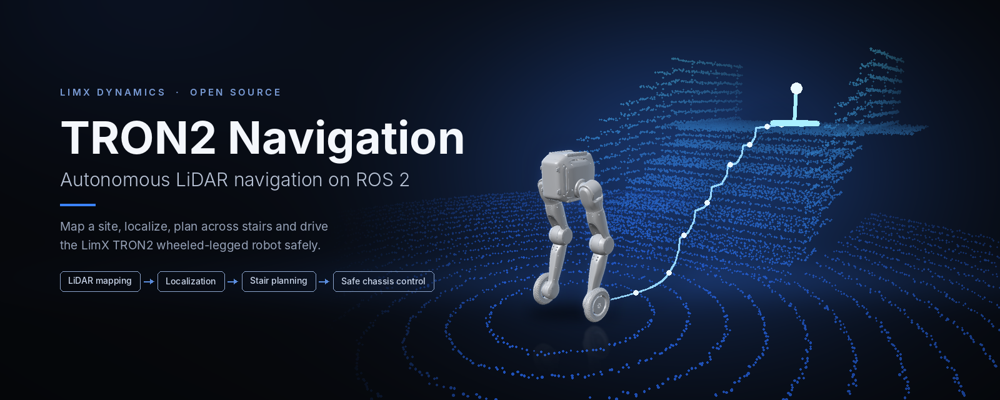
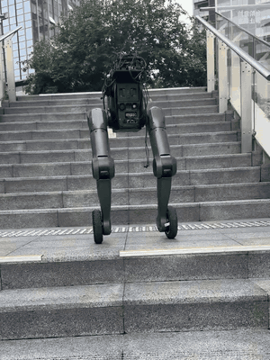
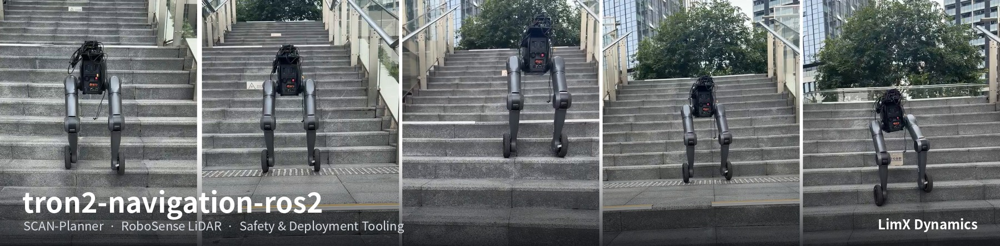
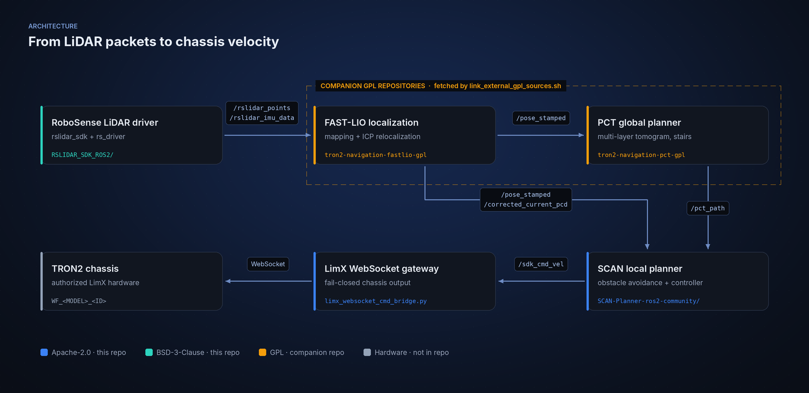
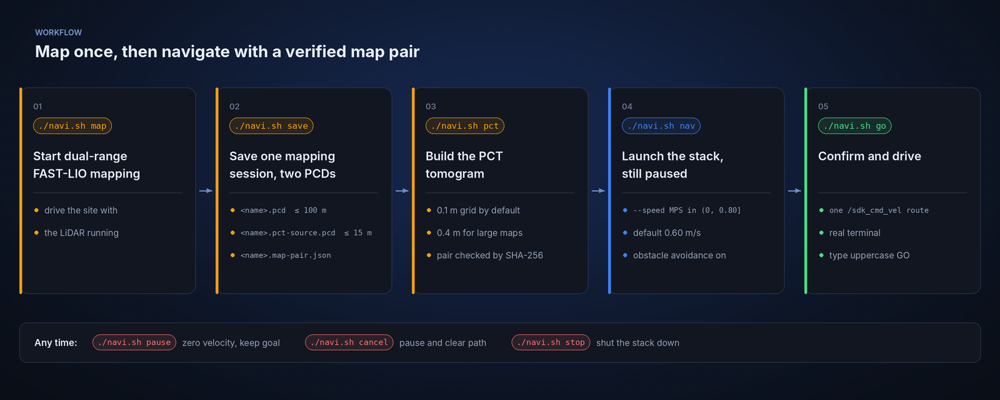
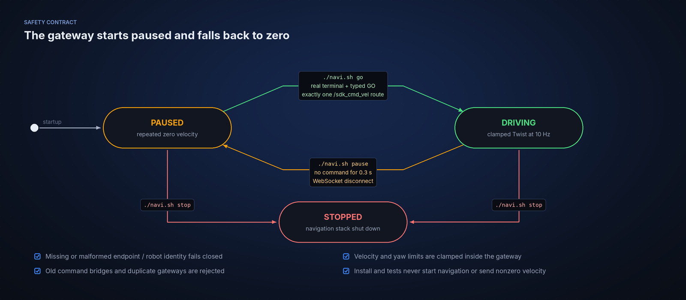

<p align="center">
  
</p>

<p align="center">
  <a href="README.md">English</a> | <a href="README_zh-CN.md">中文</a>
</p>

<p align="center">
  <a href="LICENSE"></a>
  <a href="https://github.com/limxdynamics/tron2-navigation-ros2/actions/workflows/ci.yml"></a>
  <a href="https://docs.ros.org/en/humble/"></a>
  
  
  <a href="https://github.com/limxdynamics/tron2-navigation-ros2/tags"></a>
</p>

# TRON2 Navigation for ROS 2

Autonomous navigation for the LimX TRON2 wheeled-legged robot on ROS 2 Humble:
RoboSense LiDAR in, FAST-LIO localization, PCT global planning over stairs,
SCAN local planning, and a fail-closed WebSocket gateway to the chassis.

> This repository holds the permissively licensed part of the stack. FAST-LIO and
> PCT live in two companion GPL repositories that one command fetches and verifies;
> see [Licensing boundary](#licensing-boundary).

## Highlights

- **Plans across floors and stairs.** PCT builds a multi-layer tomogram from the
  near-field map and plans across levels; SCAN follows the path with local
  obstacle avoidance, which stays on in normal navigation.
- **One mapping session, two verified maps.** A full-range localization PCD and a
  near-field PCT source PCD are saved together and bound by a SHA-256 manifest, so
  a mixed or modified pair is rejected at activation.
- **A chassis gateway that fails closed.** Navigation starts paused, velocity and
  yaw are clamped, and a 0.3 s command gap or a lost connection latches pause and
  sends repeated zero.
- **Five commands from an empty site to motion.** `./navi.sh map`, `save`, `pct`,
  `nav`, `go`, with `pause`, `cancel` and `stop` available at any time.
- **Reproducible, license-clean source.** A one-command installer for Ubuntu 22.04
  aarch64, GPL companions pinned to verified `v1.1.0` commits, and a SHA-256
  source inventory with an audit script.
- **Testable without a robot.** 47 unit tests run with nothing but `pytest`,
  using local WebSocket stubs and RFC 5737 documentation addresses.

## On a real robot

<p align="center">
  
</p>

<p align="center">
  
</p>

## What is in the stack

| Component | Role | License | Where |
|---|---|---|---|
| RoboSense `rslidar_sdk`, `rs_driver`, `rslidar_msg` | LiDAR driver, publishes `/rslidar_points` and `/rslidar_imu_data` | BSD-3-Clause | [`RSLIDAR_SDK_ROS2/`](RSLIDAR_SDK_ROS2), [`RSLIDAR_MSG_ROS2/`](RSLIDAR_MSG_ROS2) |
| SCAN-Planner, production subset | Local planning, obstacle avoidance and path tracking, publishes `/sdk_cmd_vel` | Apache-2.0 | [`SCAN-Planner-ros2-community/`](SCAN-Planner-ros2-community) |
| LimX WebSocket gateway | The only velocity route to the chassis; starts paused and fails closed | Apache-2.0 | [`limx_websocket_cmd_bridge.py`](SCAN-Planner-ros2-community/src/planner/plan_manage/scripts/limx_websocket_cmd_bridge.py) |
| Deployment and safety tooling | `install.sh`, `navi.sh`, map tools, source audit | Apache-2.0 | repository root, [`deployment/`](deployment) |
| FAST-LIO mapping and localization | Builds the map pair, publishes `/pose_stamped` | GPL-2.0-only | [tron2-navigation-fastlio-gpl](https://github.com/limxdynamics/tron2-navigation-fastlio-gpl) |
| PCT global planner | Plans over stairs and floors, publishes `/pct_path` | GPLv2-or-later | [tron2-navigation-pct-gpl](https://github.com/limxdynamics/tron2-navigation-pct-gpl) |

## Architecture

<p align="center">
  
</p>

### External runtime integration

After compatible external GPL repositories have been checked out in their
expected sibling directories and built into separate install prefixes, the
existing integration scripts can orchestrate them through ROS 2 topics. The
important interfaces are:

| Producer | Consumer | Interface |
|---|---|---|
| RoboSense | FAST-LIO | `/rslidar_points` (`sensor_msgs/PointCloud2`) and `/rslidar_imu_data` (`sensor_msgs/Imu`) |
| Localization | PCT | `/pose_stamped` (`geometry_msgs/PoseStamped`) |
| Localization | SCAN | `/pose_stamped` and `/corrected_current_pcd` |
| PCT | SCAN | `/pct_path` (`nav_msgs/Path`) |
| SCAN controller | LimX gateway | `/sdk_cmd_vel` (`geometry_msgs/Twist`) |

Map, frame, QoS, timestamp, and version compatibility must be validated by the
deployer. PCD/PCT maps are runtime data and are intentionally absent.

## Quick start in 30 seconds

No ROS 2, robot or GPU is needed for this check. It runs the included unit tests
on any Linux machine with Git and Python 3:

```bash
git clone https://github.com/limxdynamics/tron2-navigation-ros2.git
cd tron2-navigation-ros2
pip install pytest
python3 -m pytest tests \
  SCAN-Planner-ros2-community/src/planner/plan_manage/test/test_limx_websocket_cmd_bridge.py \
  SCAN-Planner-ros2-community/src/planner/plan_manage/test/test_chassis_configuration.py
./navi.sh help
```

Expect `47 passed, 1 skipped`; the skipped test runs once the FAST-LIO companion
repository has been linked. To look at the robot itself, open the TRON2 wheeled model from
[tron2-robot-description](https://github.com/limxdynamics/tron2-robot-description)
in the MuJoCo viewer:

```bash
pip install mujoco
git clone https://github.com/limxdynamics/tron2-robot-description.git
cd tron2-robot-description
python3 -m mujoco.viewer --mjcf=tron2a/WF_*/xml/robot.xml  # wheeled TRON2A model
```

## What can be built without GPL dependencies

On Ubuntu 22.04 aarch64 with ROS 2 Humble:

```bash
./install.sh nx --bootstrap --jobs 4 --with-tests
```

On an already prepared Humble NX, omit `--bootstrap`. Use
`--preflight-only` for a read-only environment check. This builds and verifies
only the included RoboSense and production SCAN packages. It does not download
GPL code, start navigation, connect to a chassis, or send velocity commands.

The included WebSocket bridge tests use local stubs and RFC 5737 documentation
addresses, so its protocol validation does not require robot hardware.

## Full navigation requires external GPL programs

The complete production chain is:

```text
RoboSense (BSD-3-Clause)
  -> external FAST-LIO/localization (GPL-2.0-only)
  -> external PCT global planner (GPLv2-or-later)
  -> SCAN local planner/controller (Apache-2.0)
  -> LimX legacy WebSocket gateway (Apache-2.0)
```

### v1.1.0 integration changes

- one FAST-LIO mapping session saves a full-range localization PCD and a
  near-field PCT-source PCD as a recoverable transaction;
- a manifest binds both PCD names, SHA-256 values, frame, ranges, and mapping
  session, and map activation rejects mixed or modified pairs;
- FAST-LIO registration uses its own near-field limit (15 m by default) while
  the complete localization map can retain 100 m data;
- PCT conversion accepts an explicit resolution, including 0.4 m for maps too
  large for a 0.2 m monolithic tomogram on a 16 GiB NX;
- `navi.sh nav --no-obstacle-avoidance --speed MPS` is an explicit hazardous
  maintenance mode that starts paused, caps speed at 0.60 m/s, and requires a
  separate `NO_OBSTACLE_GO` confirmation;
- `--stair-centerline` additionally enables the validated PCT stair-centerline
  algorithm and is rejected unless that maintenance mode is active.

The no-obstacle mode intentionally disables the local cloud subscription; it
must not be treated as a normal navigation default. Normal navigation keeps
local obstacle avoidance enabled.

The compatible GPL source is published separately so that its GPL terms remain
intact:

| Runtime unit | Repository | Commit | Tag |
|---|---|---|---|
| FAST-LIO mapping and localization | <https://github.com/limxdynamics/tron2-navigation-fastlio-gpl> | `0fbf6e9cca72a66c330a22d13823f52d49f05948` | `v1.1.0` |
| PCT global planner | <https://github.com/limxdynamics/tron2-navigation-pct-gpl> | `1c553202e50798819715679a7f8c8a878b247ace` | `v1.1.0` |

The upstream clone URLs and baseline commits are documented in
[GPL_EXTERNAL_DEPENDENCIES.md](docs/GPL_EXTERNAL_DEPENDENCIES.md). Do not use
those upstream baselines as substitutes for the compatible derivative commits
listed above.

### Recommended automatic setup

A normal `git clone` never executes repository scripts, so cloning the main
repository alone does not immediately contact the two GPL repositories. Clone
the main repository, then use the checked-in fetcher:

```bash
mkdir tron2-navigation-workspace
cd tron2-navigation-workspace
git clone https://github.com/limxdynamics/tron2-navigation-ros2.git
cd tron2-navigation-ros2
./deployment/link_external_gpl_sources.sh --fetch --verify-only
```

The fetcher creates the two missing public GPL clones beside the main clone,
checks out their fixed `v1.1.0` tags, verifies the exact commits and source
inventories, and leaves existing paths unchanged. The resulting layout is:

```text
tron2-navigation-workspace/
  tron2-navigation-ros2/
  tron2-navigation-fastlio-gpl/
  tron2-navigation-pct-gpl/
```

On a prepared Ubuntu 22.04 aarch64 system with ROS 2 Humble, build all three
source units with:

```bash
./install.sh full-nx --jobs 4 --with-tests
```

Running `full-nx` directly also fetches either missing GPL repository before
building. On a fresh supported system, install the required system dependencies
as part of the build:

```bash
./install.sh full-nx --bootstrap --jobs 4 --with-tests
```

Use this `--bootstrap` form for a newly flashed NX rather than the prepared-NX
form. It explicitly installs the Open3D, transforms3d, websocket-client, PCL,
BLAS/LAPACK, compiler, ROS 2, and test dependencies that were required during
the clean-NX deployment, then installs the CUDA PCT map tools in the isolated
`.map-tools/site` directory. The installer verifies required Python/ROS modules
and runs a small CuPy computation before compiling, so an incomplete runtime
fails during setup rather than after deployment.

Use `--preflight-only` for a read-only check of repositories that have already
been downloaded. The installer creates only ignored local compatibility links
and separate generated install prefixes. It does not start navigation or send
chassis commands.

### Manual clone alternative

To download the dependencies manually instead, run these commands from the
parent of `tron2-navigation-ros2`:

```bash
git clone --branch v1.1.0 https://github.com/limxdynamics/tron2-navigation-fastlio-gpl.git
git clone --branch v1.1.0 https://github.com/limxdynamics/tron2-navigation-pct-gpl.git
cd tron2-navigation-ros2
./deployment/link_external_gpl_sources.sh --verify-only
```

## Hardware and firmware prerequisites

Full chassis operation is impossible without authorized compatible LimX
hardware, firmware, signaling service, and a valid assigned robot identity.
See [HARDWARE_COMPATIBILITY.md](docs/HARDWARE_COMPATIBILITY.md).

Copy the public template to an untracked site file only on the target robot:

```bash
cp config/navigation.env.example config/navigation.env
${EDITOR:-vi} config/navigation.env
```

The operational endpoint and robot identity have no defaults. Chassis output
starts disabled and paused. The LimX legacy WebSocket gateway is the sole
supported velocity route; old MROS command forwarding and protocol probing are
not included.

Source delivery does not include localization/PCT maps, endpoint or identity
values, authorization, calibration, ROS 2, CUDA, or generated binaries. After
installation, provide the site configuration and generate a matched map pair
before starting navigation.

On authorized compatible hardware, the normal post-build workflow is:

```bash
./navi.sh map
./navi.sh save
./navi.sh pct
./navi.sh nav
# After checking localization, paths, safety clearance, and the emergency stop:
./navi.sh go
```

<p align="center">
  
</p>

Use `./navi.sh pause`, `./navi.sh cancel`, and `./navi.sh stop` to pause motion,
cancel a goal, and stop the complete navigation stack. Do not run `go` until the
site configuration, map pair, localization, unique command route, and physical
safety checks have all passed.

## Source integrity

Run the scoped source check against an extracted release:

```bash
./deployment/audit_permissive_source.sh /path/to/extracted/repository
```

The check verifies the source inventory, license files, absence of GPL source
roots and simulator/demo dependencies, privacy placeholders, generated/binary
files, path length, Markdown links, Git trackability, and executable bits.

## License

The original integration code, deployment helpers, tests, and documentation in
this repository are distributed under the Apache License 2.0 in
[`LICENSE`](LICENSE), with copyright held by LimX Dynamics Technology Co., Ltd.
SPDX identifier: `Apache-2.0`.

Third-party components keep their own licenses and notices; their attribution
is recorded in [`THIRD_PARTY_NOTICES.md`](THIRD_PARTY_NOTICES.md) and in the
`LICENSE` / `NOTICE` files inside each component directory. The scope of the
top-level license is described in [`LICENSING.md`](LICENSING.md), and the
separately licensed companion repositories are listed in
[`docs/GPL_EXTERNAL_DEPENDENCIES.md`](docs/GPL_EXTERNAL_DEPENDENCIES.md).

## Licensing boundary

This repository publishes the permissively licensed parts of the navigation
integration:

- LimX-owned ROS 2 integration, deployment, safety, and test code under the
  top-level Apache-2.0 license;
- the production ROS 2 SCAN-Planner subset under Apache-2.0, whose ROS 2 port
  layer is an external community contribution with the LimX Dynamics production
  integration built on top of it;
- RoboSense `rslidar_sdk`, embedded `rs_driver`, and `rslidar_msg` under
  BSD-3-Clause.

`FAST_LIO`, `FAST_LIO_LOCALIZATION2`, PCT_planner, their embedded code, and their
Git history are intentionally not included. They are external GPL dependencies.
See [GPL external dependencies](docs/GPL_EXTERNAL_DEPENDENCIES.md),
[license scope](LICENSING.md), [third-party notices](THIRD_PARTY_NOTICES.md),
and [hardware compatibility](docs/HARDWARE_COMPATIBILITY.md).

## Repository scope

The top-level Apache-2.0 license covers only original integration files whose
copyright is held by LimX Dynamics Technology Co., Ltd. Every third-party
component keeps its own LICENSE and NOTICE. No GPL source, GPL header, GPL Python extension,
GPL binary, map, recording, generated build output, deployment snapshot, site
credential, private network address, or robot identity is distributed here.

The excluded GPL programs are independent ROS 2 processes in the deployed
system. Cross-component integration uses ROS 2/DDS messages and documented
files rather than linking a GPL library into the included SCAN or RoboSense
binaries. This engineering separation does not itself make a legal
aggregation/derivative-work determination.

### SCAN-Planner attribution

`SCAN-Planner-ros2-community/` combines two separately owned contributions. Its
ROS 2 port layer - ROS 2 Humble, ament_cmake, colcon, rclcpp, tf2_ros, RViz2 and
the launch integration - is an external community contribution written in full
by an individual contributor, `xiaoqi371317`, and published as the upstream
`ros2-community` branch of <https://github.com/wuyi2121/SCAN-Planner>. That
contributor is not an original SCAN-Planner research author and is not
affiliated with LimX Dynamics. The production integration built on top of that
layer is LimX Dynamics' own work under the top-level Apache-2.0 license. See
[SCAN-Planner-ros2-community/NOTICE](SCAN-Planner-ros2-community/NOTICE) for the
file-level split and the Apache-2.0 Section 4(b) modification notice.

## Safety contract

<p align="center">
  
</p>

- startup is paused;
- missing or malformed endpoint/identity fails closed;
- velocity and yaw limits are enforced;
- communication timeout or disconnect latches pause and sends repeated zero;
- old command bridges and duplicate gateways are rejected;
- resume requires a real terminal and uppercase `GO`;
- installation and tests never start navigation or send nonzero velocity.
